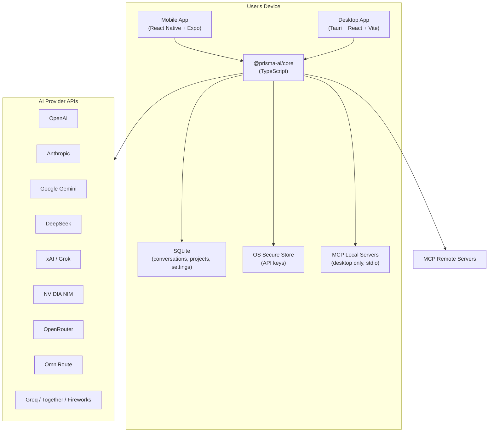
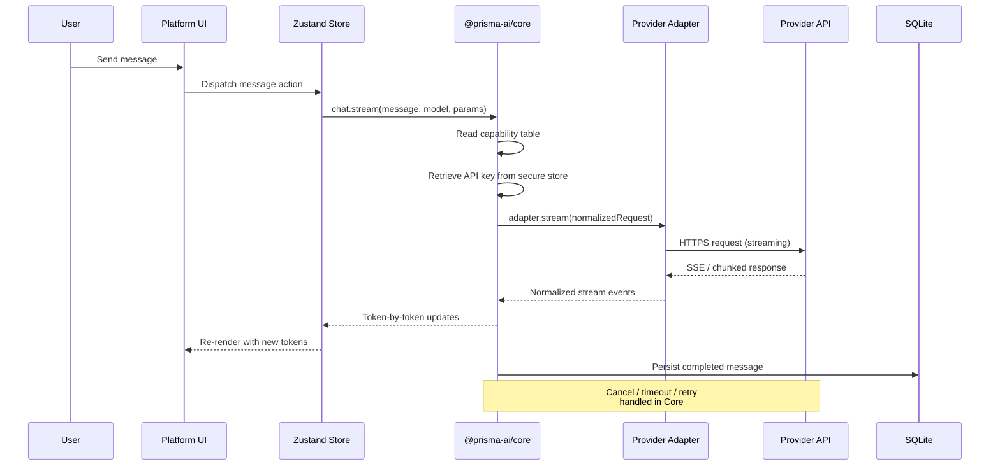
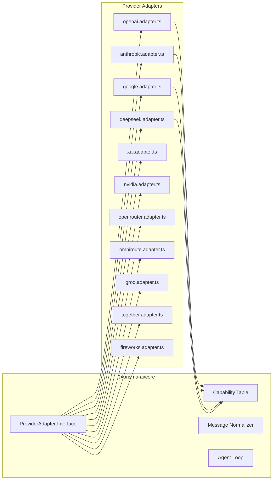
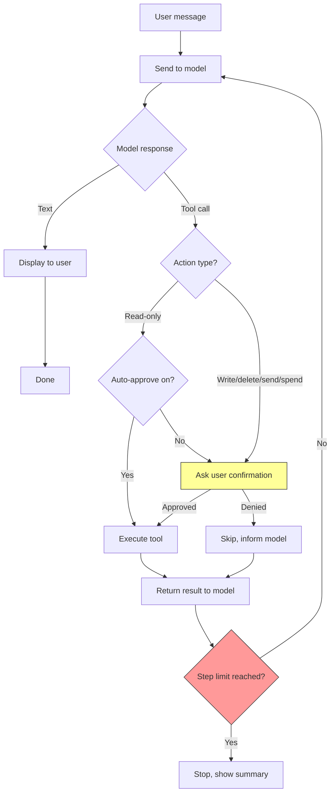
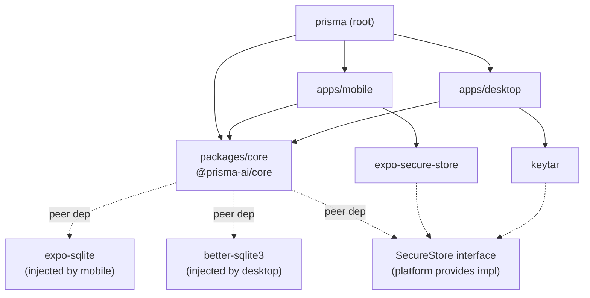

# Prisma — Architecture Document

---

## 1. High-Level Architecture

Prisma is a local-first, multi-platform AI client. There is no backend. The user's device talks directly to provider APIs. All data (conversations, projects, settings) lives on-device in SQLite. API keys live in the OS secure store and never leave it except to authenticate with the provider.

The system is a Turborepo monorepo with three main packages: a shared TypeScript core (`@prisma-ai/core`), a React Native + Expo mobile app (`apps/mobile`), and a Tauri + React + Vite desktop app (`apps/desktop`). The core package contains all business logic — provider adapters, message normalization, the agent loop, tool/skill/plugin systems, the entitlements layer, and the capability table. The platform apps are thin UI shells that consume the core.

### System Context



### Data Flow — Chat Request



### Provider Abstraction Layer



Every adapter implements the same `ProviderAdapter` interface: `chat()`, `stream()`, `listModels()`, `cancel()`, and optional `generateImage()`, `speechToText()`, `textToSpeech()`, `embed()`. The capability table declares per-model what is supported. The UI reads this table to show/hide features. Adding a new provider means adding one adapter file, one test file, and one capability-table entry. Nothing else changes.

All messages, tool calls, errors, and streaming events are normalized into an internal format before reaching the UI. Provider-specific fields go in an `extra` field so nothing is lost.

### Agent Loop



The agent loop always enforces a step limit. A user-visible stop button is available at every step. A running cost estimate is displayed during execution. Tool results, web content, and files are treated as untrusted — prompt injection defenses are mandatory.

---

## 2. Technology Stack

### Runtime & Languages

| Layer | Technology | Reason |
|---|---|---|
| Shared core | TypeScript (strict mode) | Single language for all business logic. Shared between mobile and desktop. |
| Mobile app | React Native + Expo | Cross-platform iOS/Android from one codebase. Expo simplifies builds, OTA updates, and native module access. |
| Desktop app | Tauri v2 + React + Vite | Lightweight native shell (Rust). Much smaller than Electron. Shares TS core with mobile via the monorepo. |
| Desktop backend | Rust (Tauri internals) | Tauri's native layer. Used for OS keychain bindings, file system access, MCP stdio server management. |
| Build tooling | Python (occasional) | Only for scripting where it's the better tool. Reason stated whenever used. |

### Monorepo & Package Management

| Tool | Choice | Reason |
|---|---|---|
| Package manager | pnpm | Fast, strict dependency resolution, disk-efficient content-addressed store. Works well with monorepo workspaces. |
| Monorepo orchestrator | Turborepo | Simple config, fast remote caching, good TypeScript monorepo support. Lower overhead than Nx for a solo builder. |
| Workspaces | pnpm workspaces | Defined in root `pnpm-workspace.yaml`. Packages: `packages/core`, `apps/mobile`, `apps/desktop`. |

### UI & State

| Concern | Mobile | Desktop |
|---|---|---|
| UI framework | React Native | React (Vite) |
| Navigation | Expo Router (file-based) | React Router or Tanstack Router |
| State management | Zustand | Zustand |
| Styling | React Native StyleSheet | Tailwind CSS |
| Markdown rendering | `react-native-markdown-display` | `react-markdown` + `rehype-sanitize` |

Zustand stores live in the core package where possible (provider state, conversation state, entitlements). Platform-specific UI state (navigation, layout, keyboard) stays in the platform app.

### Data & Storage

| Concern | Technology | Details |
|---|---|---|
| Conversations, projects, settings | SQLite | Local on-device. Accessed via `expo-sqlite` (mobile) and `better-sqlite3` or Tauri SQL plugin (desktop). |
| API key storage | OS secure store | `expo-secure-store` on mobile (iOS Keychain, Android Keystore). `keytar` on desktop (OS keychain bindings). |
| File storage | Local filesystem | Uploaded files and generated images stored in app-local directories. |
| Search | SQLite FTS5 | Full-text search over conversation history. Built into SQLite, no extra dependency. |

### Testing

| Scope | Runner | Details |
|---|---|---|
| Core package | Vitest | Fast, native ESM, TypeScript support without transform overhead. |
| Mobile app | Jest | Expo's default. Same assertion style as Vitest. |
| Desktop app | Vitest | Matches core package runner. |
| All adapters | Vitest | Every adapter has a test file. All provider responses are mocked. Never calls real APIs in tests. |
| E2E (future) | Detox (mobile), Playwright (desktop) | Not in M1. Add when UI stabilizes. |

### CI/CD

| Pipeline | Tool | Details |
|---|---|---|
| Lint, type-check, unit tests | GitHub Actions | Runs on every push and PR. Matrix: Node 20, pnpm. |
| Mobile builds (iOS) | Expo EAS Build | Cloud build — no local Mac needed. Triggered from CI or CLI. |
| Mobile builds (Android) | Expo EAS Build or local | Can build locally on Ubuntu (Android SDK). EAS as fallback. |
| Desktop builds (Windows) | GitHub Actions (windows-latest) | Tauri build, output `.msi` / `.exe` installer. |
| Desktop builds (macOS) | GitHub Actions (macos-latest) | Tauri build, output `.dmg`. No local Mac needed. |
| Desktop builds (Linux) | GitHub Actions (ubuntu-latest) or local | Tauri build, output `.AppImage` / `.deb`. Lowest priority. |

### Security (non-negotiable)

API keys live only in the OS secure store. Never in AsyncStorage, SQLite, plain files, logs, crash reports, or source control. Keys go from the device straight to the provider — no middle server. No telemetry without explicit opt-in. All rendered model output (markdown, links, HTML, code) is sanitized. Tool results and MCP content are untrusted.

---

## 3. Folder Structure

```
prisma/
├── .github/
│   └── workflows/
│       ├── ci.yml                          # Lint, type-check, test (all packages)
│       ├── build-mobile.yml                # EAS build triggers for iOS/Android
│       ├── build-desktop-windows.yml       # Tauri build on windows-latest
│       ├── build-desktop-macos.yml         # Tauri build on macos-latest
│       └── build-desktop-linux.yml         # Tauri build on ubuntu-latest
│
├── apps/
│   ├── mobile/                             # React Native + Expo app
│   │   ├── app/                            # Expo Router file-based routes
│   │   │   ├── (tabs)/                     # Tab layout group
│   │   │   │   ├── index.tsx               # Chat tab (default)
│   │   │   │   ├── history.tsx             # Conversation history list
│   │   │   │   ├── projects.tsx            # Projects list
│   │   │   │   └── settings.tsx            # Settings & key management
│   │   │   ├── chat/
│   │   │   │   └── [id].tsx                # Individual chat screen
│   │   │   ├── project/
│   │   │   │   └── [id].tsx                # Project detail screen
│   │   │   └── _layout.tsx                 # Root layout (providers, theme)
│   │   ├── components/                     # Mobile-specific UI components
│   │   │   ├── ChatBubble.tsx              # Single message bubble
│   │   │   ├── ChatInput.tsx               # Message input with attachments
│   │   │   ├── ModelPicker.tsx             # Model selection dropdown
│   │   │   ├── ParameterSheet.tsx          # Temperature, max tokens, etc.
│   │   │   ├── VoiceButton.tsx             # Record / TTS toggle
│   │   │   ├── ToolCallCard.tsx            # Agent tool call display
│   │   │   ├── FilePreview.tsx             # Uploaded file/image preview
│   │   │   ├── CostEstimate.tsx            # Running cost display
│   │   │   └── EntitlementGate.tsx         # Wraps gated features
│   │   ├── hooks/                          # Mobile-specific React hooks
│   │   │   ├── useKeyboard.ts              # Keyboard avoidance
│   │   │   └── usePermissions.ts           # Camera, microphone, file access
│   │   ├── utils/
│   │   │   └── secureStore.ts              # expo-secure-store wrapper
│   │   ├── app.json                        # Expo config
│   │   ├── eas.json                        # EAS Build profiles
│   │   ├── babel.config.js
│   │   ├── metro.config.js                 # Metro bundler config (resolves core package)
│   │   ├── tsconfig.json
│   │   └── package.json
│   │
│   └── desktop/                            # Tauri + React + Vite app
│       ├── src/                             # React frontend
│       │   ├── pages/                       # Route pages
│       │   │   ├── Chat.tsx                 # Main chat view
│       │   │   ├── History.tsx              # Conversation list + search
│       │   │   ├── Projects.tsx             # Project management
│       │   │   ├── Settings.tsx             # Keys, preferences, connectors
│       │   │   └── Agents.tsx               # Agent execution dashboard
│       │   ├── components/                  # Desktop-specific UI components
│       │   │   ├── ChatBubble.tsx
│       │   │   ├── ChatInput.tsx
│       │   │   ├── ModelPicker.tsx
│       │   │   ├── ParameterPanel.tsx       # Side panel version of params
│       │   │   ├── VoiceButton.tsx
│       │   │   ├── ToolCallCard.tsx
│       │   │   ├── FilePreview.tsx
│       │   │   ├── CostEstimate.tsx
│       │   │   ├── EntitlementGate.tsx
│       │   │   ├── Sidebar.tsx              # Navigation sidebar
│       │   │   └── MCPConnectorManager.tsx  # MCP server config UI
│       │   ├── hooks/
│       │   │   └── useTauriSecureStore.ts   # keytar wrapper via Tauri invoke
│       │   ├── App.tsx                      # Root component
│       │   ├── main.tsx                     # Vite entry point
│       │   └── index.css                    # Tailwind imports
│       ├── src-tauri/                       # Tauri Rust backend
│       │   ├── src/
│       │   │   ├── main.rs                  # Tauri entry point
│       │   │   ├── commands/
│       │   │   │   ├── keychain.rs           # OS keychain read/write via keytar
│       │   │   │   ├── mcp.rs               # Spawn/manage local MCP stdio servers
│       │   │   │   └── files.rs             # File system access for uploads
│       │   │   └── lib.rs
│       │   ├── tauri.conf.json              # Tauri window, security, plugin config
│       │   ├── Cargo.toml
│       │   └── icons/                       # App icons per platform
│       ├── vite.config.ts
│       ├── tailwind.config.ts
│       ├── tsconfig.json
│       ├── index.html
│       └── package.json
│
├── packages/
│   └── core/                               # @prisma-ai/core — shared business logic
│       ├── src/
│       │   ├── providers/                   # Provider adapter layer
│       │   │   ├── types.ts                 # ProviderAdapter interface, NormalizedMessage, StreamEvent, ToolCall, etc.
│       │   │   ├── registry.ts              # Provider registry — maps provider IDs to adapters
│       │   │   ├── capability-table.ts      # Per-model capability declarations
│       │   │   ├── adapters/
│       │   │   │   ├── openai.adapter.ts
│       │   │   │   ├── anthropic.adapter.ts
│       │   │   │   ├── google.adapter.ts
│       │   │   │   ├── deepseek.adapter.ts
│       │   │   │   ├── xai.adapter.ts
│       │   │   │   ├── nvidia.adapter.ts
│       │   │   │   ├── openrouter.adapter.ts
│       │   │   │   ├── omniroute.adapter.ts
│       │   │   │   ├── groq.adapter.ts
│       │   │   │   ├── together.adapter.ts
│       │   │   │   └── fireworks.adapter.ts
│       │   │   └── __tests__/
│       │   │       ├── openai.adapter.test.ts
│       │   │       ├── anthropic.adapter.test.ts
│       │   │       ├── google.adapter.test.ts
│       │   │       ├── deepseek.adapter.test.ts
│       │   │       ├── xai.adapter.test.ts
│       │   │       ├── nvidia.adapter.test.ts
│       │   │       ├── openrouter.adapter.test.ts
│       │   │       ├── omniroute.adapter.test.ts
│       │   │       ├── groq.adapter.test.ts
│       │   │       ├── together.adapter.test.ts
│       │   │       └── fireworks.adapter.test.ts
│       │   │
│       │   ├── chat/                        # Chat session logic
│       │   │   ├── chat-session.ts          # Manages a single chat: send, stream, cancel, retry
│       │   │   ├── message-normalizer.ts    # Converts provider formats to internal NormalizedMessage
│       │   │   ├── stream-handler.ts        # SSE/chunked parsing, backoff, timeout, partial recovery
│       │   │   └── __tests__/
│       │   │       ├── chat-session.test.ts
│       │   │       ├── message-normalizer.test.ts
│       │   │       └── stream-handler.test.ts
│       │   │
│       │   ├── agents/                      # Agent loop and tool execution
│       │   │   ├── agent-loop.ts            # Loop: model call → tool call → result → repeat
│       │   │   ├── tool-executor.ts         # Runs tool calls, enforces permissions
│       │   │   ├── cost-estimator.ts        # Token counting, per-model pricing, running total
│       │   │   ├── step-limiter.ts          # Enforces max steps, exposes stop signal
│       │   │   └── __tests__/
│       │   │       ├── agent-loop.test.ts
│       │   │       ├── tool-executor.test.ts
│       │   │       └── cost-estimator.test.ts
│       │   │
│       │   ├── mcp/                         # MCP connector layer
│       │   │   ├── mcp-client.ts            # MCP protocol client (JSON-RPC over stdio or HTTP)
│       │   │   ├── mcp-registry.ts          # Manages configured MCP servers
│       │   │   ├── mcp-types.ts             # MCP protocol types
│       │   │   └── __tests__/
│       │   │       └── mcp-client.test.ts
│       │   │
│       │   ├── skills/                      # Skill and plugin system
│       │   │   ├── skill-loader.ts          # Reads skill folders, parses instruction files
│       │   │   ├── plugin-loader.ts         # Reads plugin bundles (skills + connector configs)
│       │   │   ├── skill-types.ts           # Skill, Plugin, SkillResource type definitions
│       │   │   └── __tests__/
│       │   │       ├── skill-loader.test.ts
│       │   │       └── plugin-loader.test.ts
│       │   │
│       │   ├── db/                          # Database layer
│       │   │   ├── schema.ts                # SQLite table definitions and migrations
│       │   │   ├── conversations.ts         # CRUD for conversations and messages
│       │   │   ├── projects.ts              # CRUD for projects
│       │   │   ├── settings.ts              # User preferences
│       │   │   ├── search.ts                # FTS5 full-text search
│       │   │   └── __tests__/
│       │   │       ├── conversations.test.ts
│       │   │       ├── projects.test.ts
│       │   │       └── search.test.ts
│       │   │
│       │   ├── entitlements/                # Feature gating
│       │   │   ├── entitlements.ts           # Single-flag check per feature. All on at launch.
│       │   │   └── __tests__/
│       │   │       └── entitlements.test.ts
│       │   │
│       │   ├── voice/                       # Voice input/output
│       │   │   ├── stt.ts                   # Speech-to-text routing (provider STT or fallback)
│       │   │   ├── tts.ts                   # Text-to-speech routing
│       │   │   └── __tests__/
│       │   │       ├── stt.test.ts
│       │   │       └── tts.test.ts
│       │   │
│       │   ├── media/                       # Image generation, video input
│       │   │   ├── image-gen.ts             # Image generation routing
│       │   │   ├── video-input.ts           # Video frame extraction fallback
│       │   │   └── __tests__/
│       │   │       ├── image-gen.test.ts
│       │   │       └── video-input.test.ts
│       │   │
│       │   ├── security/                    # Security utilities
│       │   │   ├── sanitize.ts              # HTML/markdown sanitization for rendered output
│       │   │   ├── key-manager.ts           # Abstract interface for secure key storage
│       │   │   └── prompt-guard.ts          # Prompt injection detection for tool results
│       │   │
│       │   └── index.ts                     # Public API barrel export
│       │
│       ├── vitest.config.ts
│       ├── tsconfig.json
│       └── package.json
│
├── docs/                                    # Project documentation (this folder)
│   ├── PRD.md
│   ├── ARCHITECTURE.md                      # This file
│   ├── DESIGN.md
│   ├── RULES.md
│   ├── TASK.md
│   └── MEMORY.md
│
├── scripts/                                 # Build and utility scripts
│   ├── setup.sh                             # First-time dev environment setup
│   └── verify-keys-not-leaked.sh            # Pre-commit hook: scan for key patterns
│
├── turbo.json                               # Turborepo pipeline config
├── pnpm-workspace.yaml                      # Workspace definitions
├── package.json                             # Root: scripts, devDependencies (shared lint, format)
├── tsconfig.base.json                       # Shared TS compiler options
├── .eslintrc.js                             # Shared ESLint config
├── .prettierrc                              # Code formatting
├── .gitignore
└── README.md
```

### Package Dependency Graph



The core package defines abstract interfaces for platform-specific concerns (secure storage, SQLite driver, file system). Each platform app injects its implementation at startup. This keeps the core package free of platform dependencies while letting it own all the logic.

---

## 4. SQLite Schema

Core tables for M1–M4. Later milestones add columns and tables incrementally.

```sql
-- Conversations
CREATE TABLE conversations (
    id              TEXT PRIMARY KEY,       -- UUID
    project_id      TEXT,                   -- FK to projects.id (nullable, M4)
    title           TEXT,                   -- Auto-generated or user-set
    model_id        TEXT NOT NULL,          -- e.g. "openai:gpt-4o"
    provider_id     TEXT NOT NULL,          -- e.g. "openai"
    system_prompt   TEXT,                   -- Custom system prompt (nullable)
    parameters      TEXT,                   -- JSON: {temperature, max_tokens, top_p, ...}
    created_at      INTEGER NOT NULL,       -- Unix timestamp ms
    updated_at      INTEGER NOT NULL,
    FOREIGN KEY (project_id) REFERENCES projects(id) ON DELETE SET NULL
);

-- Messages
CREATE TABLE messages (
    id              TEXT PRIMARY KEY,       -- UUID
    conversation_id TEXT NOT NULL,          -- FK to conversations.id
    role            TEXT NOT NULL,          -- 'user' | 'assistant' | 'system' | 'tool'
    content         TEXT,                   -- Text content (nullable for tool calls)
    tool_calls      TEXT,                   -- JSON array of tool call objects (nullable)
    tool_call_id    TEXT,                   -- For tool-result messages (nullable)
    attachments     TEXT,                   -- JSON array of {type, path, mime} (nullable)
    model_id        TEXT,                   -- Model that generated this (nullable for user msgs)
    token_count     INTEGER,               -- Tokens used (nullable)
    cost            REAL,                   -- Estimated cost in USD (nullable)
    extra           TEXT,                   -- JSON: provider-specific fields
    created_at      INTEGER NOT NULL,
    FOREIGN KEY (conversation_id) REFERENCES conversations(id) ON DELETE CASCADE
);

-- Projects (M4)
CREATE TABLE projects (
    id              TEXT PRIMARY KEY,       -- UUID
    name            TEXT NOT NULL,
    instructions    TEXT,                   -- Project-level system prompt
    settings        TEXT,                   -- JSON: default model, params, enabled skills
    created_at      INTEGER NOT NULL,
    updated_at      INTEGER NOT NULL
);

-- Project files (M4)
CREATE TABLE project_files (
    id              TEXT PRIMARY KEY,       -- UUID
    project_id      TEXT NOT NULL,
    filename        TEXT NOT NULL,
    mime_type       TEXT NOT NULL,
    path            TEXT NOT NULL,          -- Local filesystem path
    size_bytes      INTEGER NOT NULL,
    created_at      INTEGER NOT NULL,
    FOREIGN KEY (project_id) REFERENCES projects(id) ON DELETE CASCADE
);

-- MCP connector configs (M8)
CREATE TABLE mcp_connectors (
    id              TEXT PRIMARY KEY,       -- UUID
    name            TEXT NOT NULL,
    transport       TEXT NOT NULL,          -- 'stdio' | 'http'
    config          TEXT NOT NULL,          -- JSON: command, args, url, headers, etc.
    enabled         INTEGER NOT NULL DEFAULT 1,
    project_id      TEXT,                   -- Scoped to project (nullable = global)
    created_at      INTEGER NOT NULL,
    FOREIGN KEY (project_id) REFERENCES projects(id) ON DELETE CASCADE
);

-- FTS5 virtual table for search (M2)
CREATE VIRTUAL TABLE messages_fts USING fts5(
    content,
    content=messages,
    content_rowid=rowid
);

-- Settings (key-value, M2)
CREATE TABLE settings (
    key             TEXT PRIMARY KEY,
    value           TEXT NOT NULL
);

-- Entitlements (M2)
CREATE TABLE entitlements (
    feature         TEXT PRIMARY KEY,       -- e.g. 'voice', 'image_gen', 'agents', 'mcp'
    enabled         INTEGER NOT NULL DEFAULT 1
);
```

---

*Last updated: 2026-10-25*
